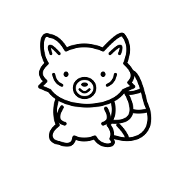

<div align="center">


# OmniFlow

**Dictate. Read. Ask. Stay in flow.**

A native Apple app for voice, reading and local AI assistance — with an optional Mac notch island for your coding agents and everyday controls.

[Development guide](docs/public/development.md) · [Privacy & permissions](docs/public/privacy.md) · [Contributing](CONTRIBUTING.md) · [Security](SECURITY.md)

</div>

OmniFlow brings speech, text tools, EPUB narration and an assistant into one SwiftUI application. Its Mac experience also includes agent session monitoring, focus-following controls and a compact island that works on displays with or without a notch. The assistant is called **Omni**.

**Experimental source release.** This repository contains macOS and iPhone/iPad implementations, not a promise of feature parity or a production-ready signed download. The current project targets **macOS 27 and iOS 27**, with **Xcode 27**. Device permissions, model availability, signing and provisioning affect which features work. App Store configurations exist; their presence does not imply review approval.

## What you can explore

| Area | Implementation |
| --- | --- |
| Voice and writing | Mac Fn dictation, hands-free recording, cleanup, translation, insertion and searchable history; iOS dictation and a companion keyboard extension. |
| Reader | EPUB import, library navigation, search, reading position and local Kokoro narration on Mac, iPhone and iPad. |
| Assistant | Apple Foundation Models, local tools and memory; an optional MLX model backend on Mac. Models and speech assets may require downloads. |
| Coding agents | Mac session views and hook integrations for Claude Code, Codex, Gemini CLI and Antigravity. Approval support depends on the agent and its hook contract. |
| Mac workspace | Optional notch island, monitoring, shortcuts, focus-following behavior and configurable ambient watches. |
| Connections | Explicitly configured local or remote MCP servers. Tools must be discovered and allowed; a connected tool can read or change external data. |
| Sync | Opt-in CloudKit implementation for selected transcript, Reader and preference data. Requires your own provisioning and cross-device validation. |

On Mac, hold **Fn** to dictate, press **Fn + Space** for hands-free recording, and **Escape** to cancel. The voice pill can dock at the left, right or bottom edge. Features requiring access to other apps need the appropriate macOS permissions.

## Build from source

Use an Apple silicon Mac, macOS 27, Xcode 27, XcodeGen, Python 3 and Go 1.27 or newer. Apple Intelligence features also require supported hardware, settings, language and installed model assets. Package dependencies and optional model installation need network access.

```sh
git clone https://github.com/mmingo-director-of-ai/omniflow.git
cd omniflow
brew install xcodegen
cd OmniFlow
xcodegen generate
open OmniFlow.xcodeproj
```

Select the **OmniFlow** scheme for Mac or **OmniFlowiOS** for iPhone/iPad. Configure your own signing team for installation on a device. The Atlas helper uses the pinned, licensed SDK in `Vendor/AtlasSDK`; no private repository access is required. A signing-disabled build can check compilation, but does not establish that microphone, accessibility, extensions or iCloud work on a device.

See the [development guide](docs/public/development.md) for command-line builds, tests, architecture and distribution limitations.

## Local inference, explicit network features

Speech and supported assistant backends run locally. That does **not** mean the entire application is offline: initial model downloads, configured MCP connections, optional iCloud sync and network-backed widgets can contact external services. Local MCP programs run with the access available to their process. Review a server and its tools before enabling it.

History and saved memory can contain sensitive text and source material. Permission-dependent features can access microphone input, selected text, screen content, local Mail or Messages caches, and other data you choose to expose. Read [Privacy & permissions](docs/public/privacy.md) before enabling them. Report vulnerabilities through [SECURITY.md](SECURITY.md), without posting credentials or private transcripts in an issue.

## Status and contributions

Useful contributions include reproducible bugs, accessibility improvements, model and speech evaluations, permission-flow fixes and clearer platform boundaries. Start with [CONTRIBUTING.md](CONTRIBUTING.md). Include your OS, Xcode version, target and minimal reproduction, with personal data removed.

Known limits include unfinished physical-device and multi-display validation, provisioned iCloud testing, platform-specific capabilities, and private API use in some development/direct-distribution paths. Native model output can be wrong; review generated text and proposed actions. Automated tests do not certify live microphone quality, narration accuracy, energy use or App Store eligibility.

## Origins and license

OmniFlow began as a fork of [Coucou](https://github.com/Louis-CFM/coucou), created by Louis Raillé, whose code and notch-island contribution remain credited. It incorporates the Freeflow dictation work and additional local assistant, Reader and monitoring components. Older `NotchLee`, `NotchBuddy` and `coucou_agent` identifiers remain in storage, helpers and hooks for compatibility.

- **Source code:** [MIT](LICENSE), with retained upstream copyright notices.
- **Original artwork:** [CC BY 4.0 with attribution](LICENSE-ASSETS.md), including reuse and adaptation. Trademark rights remain separate; upstream assets and fonts retain their own terms.
- **Dependencies, fonts and model components:** [THIRD-PARTY-NOTICES.md](THIRD-PARTY-NOTICES.md). Downloaded models have their own licenses and are not included in the source release.
